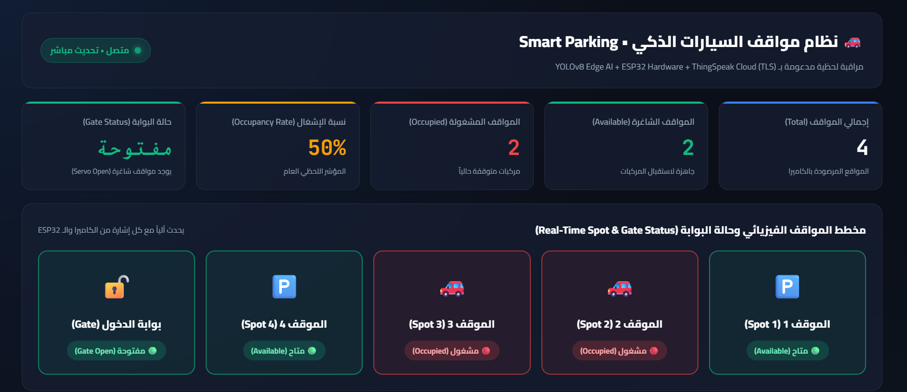
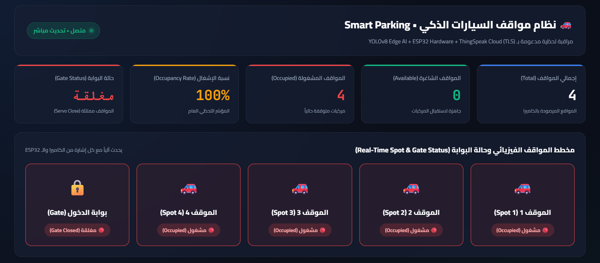
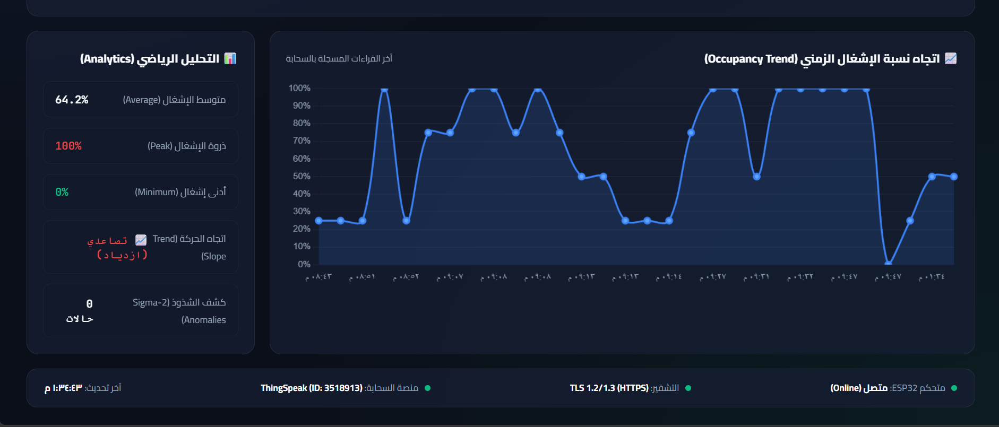
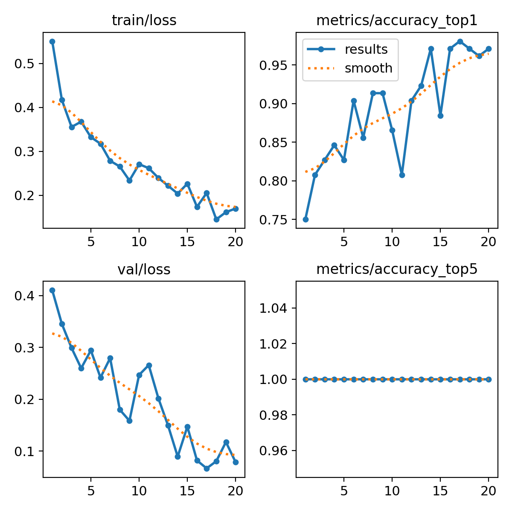
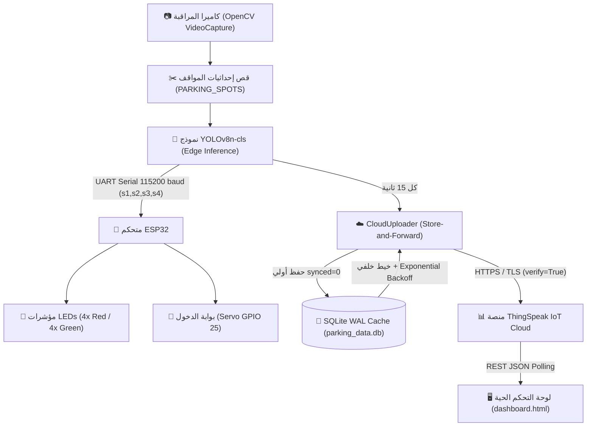

# 🅿️ مَوقِف الذكي | Mawqif-AI

<div align="center">

[](https://github.com/manaf-albana)
[](https://www.python.org)
[](https://github.com/ultralytics/ultralytics)
[](https://opencv.org)
[](https://www.espressif.com)
[](https://thingspeak.mathworks.com)
[](https://www.sqlite.org)
[](LICENSE)

**منظومة إدارة مواقف السيارات الذكية بالرؤية الحاسوبية على الحافة وإنترنت الأشياء**  
*Edge-AI Smart Parking Occupancy & Gate Control: YOLOv8n-cls Vision, ESP32 Actuation, SQLite Store-and-Forward & ThingSpeak TLS Telemetry.*

---

[🚀 البدء السريع](#-دليل-التشغيل-والبدء-السريع) • [🧠 معمارية النظام](#-معمارية-النظام-system-architecture) • [📸 واجهات المنظومة](#-واجهات-المنظومة) • [🔒 الأمان والموثوقية](#-الأمان-والاستمرارية-security--resilience) • [📬 للتواصل](#-المطور-وحقوق-الملكية)

</div>

---

## 📌 عن المنظومة (System Overview)

تُعاني مواقف السيارات التقليدية من غياب المراقبة اللحظية الدقيقة دون تكلفة حساسات أرضية مكلفة لكل موقف، إضافةً إلى فقدان بيانات القياس عند انقطاع الإنترنت في المواقع الميدانية.

صُممت منظومة **«مَوقِف الذكي | Mawqif-AI»** لتقديم نظام متكامل يدمج بين **الذكاء الاصطناعي على الحافة (Edge AI)** و**إنترنت الأشياء (IoT)** عبر مسار مزدوج:
- **رؤية حاسوبية لحظية (YOLOv8n-cls + OpenCV)**: تحليل بث الكاميرا، قص مناطق المواقف المُعايرة، وتصنيف كل موقف إلى **شاغر (`empty`)** أو **مشغول (`occupied`)** بدقة تصل إلى **98.08%** (Top-1 Validation Accuracy).
- **تحكم عتادي مباشر (ESP32 UART + Actuators)**: إرسال حالة المواقف لحظياً عبر المنفذ التسلسلي (`115200 baud`) لتشغيل مؤشرات الإضاءة (LEDs حمراء/خضراء) والتحكم الآلي في بوابة الدخول (Servo Motor) بفتحها أو إغلاقها عند الامتلاء الكامل.
- **اعتمادية انقطاع الاتصال (SQLite Store-and-Forward)**: حفظ القراءات محلياً في قاعدة بيانات **SQLite** بنمط **WAL** وإعادة مزامنتها تلقائياً في الخلفية عبر **Exponential Backoff** فور عودة الإنترنت.
- **قياس سحابي آمن ولوحة تحكم حية**: رفع البيانات عبر **HTTPS/TLS** إلى **ThingSpeak** مع لوحة تحكم تفاعلية تحسب الاتجاه الزمني وتكشف الشذوذ الإحصائي بقاعدة **2-Sigma**.

---

## 📸 واجهات المنظومة

<div align="center">

### 1. لوحة المراقبة الحية — حالة الإشغال الجزئي وبوابة الدخول مفتوحة (50%)


### 2. لوحة المراقبة الحية — الامتلاء الكامل وإغلاق البوابة آلياً (100%)


### 3. التحليلات الزمنية وكشف الشذوذ الإحصائي (Analytics & Trend Slope)


### 4. منحنيات تدريب نموذج التصنيف (YOLOv8n-cls — 20 Epochs)


</div>

---

## 🧠 معمارية النظام (System Architecture)



---

## ✨ المميزات والقدرات الهندسية (Key Features)

| المحور | التفصيل التقني |
|---|---|
| **الذكاء الاصطناعي على الحافة** | نموذج `YOLOv8n-cls` مُدرّب على 20 دورة (`imgsz=224`, `batch=16`) بعتبة ثقة `CONF_THRESHOLD = 0.70` لمنع الإنذارات الكاذبة الناتجة عن تغيّر الإضاءة. |
| **التحكم الفيزيائي (ESP32)** | تحكم لحظي بـ 4 مؤشرات حمراء (`GPIO 23, 22, 21, 19`) و4 خضراء (`GPIO 14, 18, 32, 33`) ومحرّك بوابة Servo (`GPIO 25`). |
| **إدارة الطاقة والتحديث اللاسلكي** | تفعيل وضع `WiFi.setSleep(true)` (Modem Sleep) لتقليل استهلاك الراديو، مع دعم التحديث اللاسلكي للفيرموير عبر `ArduinoOTA`. |
| **الاستمرارية عند انقطاع الشبكة** | تخزين محلي بـ `SQLite 3` مع `PRAGMA journal_mode=WAL`؛ تبقى السجلات `synced=0` عند فشل الإرسال وتُعاد مزامنتها تلقائياً بتأخير تصاعدي من `60s` إلى `900s`. |
| **لوحة تحكم وتحليل إحصائي** | واجهة ويب عربية داكنة تعرض KPIs ومخطط المواقف ومنحنى **Chart.js** مع حساب المتوسط، الذروة، الميل الخطي (`Trend Slope`)، وكشف الشذوذ (`2-Sigma`). |

---

## 📊 دقة النموذج والأداء (Model Training & Metrics)

تم ضبط نموذج التصنيف `yolov8n-cls.pt` عبر [src/train_model.py](src/train_model.py) على مجموعة بيانات مقتطعة من مواقف السيارات (`empty` و`occupied`):

- **أعلى دقة تحقق (Peak Top-1 Val Accuracy):** `98.08%` (الدورة 17 — `val/loss = 0.0667`)
- **دقة نهاية التدريب (Epoch 20 Top-1 Accuracy):** `97.12%` (`val/loss = 0.0787`)
- **عتبة القرار التشغيلية:** `CONF_THRESHOLD = 0.70` داخل [src/live_system.py](src/live_system.py)

---

## 🔒 الأمان والاستمرارية (Security & Resilience)

- **عزل الأسرار البرمجية**: مفاتيح **ThingSpeak** محفوظة داخل `.env` (بوجود قالب [`.env.example`](.env.example))، وبيانات Wi-Fi وOTA في `secrets.h` (بوجود قالب [`main_wifi/secrets.h.example`](main_wifi/secrets.h.example)) وكلاهما مستثنى في [`.gitignore`](.gitignore).
- **تشفير طبقة النقل (TLS)**: جميع طلبات Python إلى `api.thingspeak.com` تتم عبر HTTPS مع فرض `TLS_VERIFY = True` في [config/cloud_config.py](config/cloud_config.py)، واتصال ESP32 يستخدم `WiFiClientSecure` على المنفذ `443`.
- **فصل الصلاحيات**: فصل `Write API Key` (للرفع فقط) عن `Read API Key` (للقراءة والعرض في لوحة التحكم).

---

## 📂 هيكلية المشروع (Project Structure)

```text
Mawqif-AI/
├── config/
│   ├── cloud_config.py            # قراءة إعدادات ThingSpeak وTLS من ملف .env
│   └── parking_spots.py           # إحداثيات مربعات المواقف الأربعة على إطار الكاميرا
├── src/
│   ├── live_system.py             # المحرك الحي: الكاميرا + YOLOv8 + Serial + CloudUploader
│   ├── cloud_uploader.py          # محرك الرفع السحابي مع Store-and-Forward وإعادة المحاولة
│   ├── local_cache.py             # طبقة قاعدة البيانات المحلية SQLite WAL
│   ├── select_parking_spots.py    # أداة رسومية لتحديد إحداثيات المواقف بالفأرة
│   ├── capture_images.py          # التقاط صور خام للتدريب (empty / occupied)
│   ├── crop_spots.py              # قص صور المواقف وتقسيمها تلقائياً إلى train/val
│   └── train_model.py             # تدريب نموذج yolov8n-cls.pt
├── main/
│   ├── main.ino                   # كود ESP32 الأساسي (Serial + LEDs + Servo + WiFi/OTA)
│   └── secrets.h.example          # قالب بيانات الشبكة وThingSpeak
├── main_wifi/
│   ├── main_wifi.ino              # كود ESP32 النهائي (Power Sleep + HTTPS + ArduinoOTA)
│   └── secrets.h.example          # قالب بيانات الشبكة وThingSpeak
├── screenshots/                   # لقطات شاشة لوحة التحكم ومنحنيات التدريب
├── dashboard.html                 # لوحة التحكم التفاعلية الحية (RTL + Chart.js)
├── run_dashboard.py               # خادم HTTP خفيف لفتح لوحة التحكم وتمرير الإعدادات
├── run_all.py                     # نقطة التشغيل الموحدة للنظام الحي ولوحة التحكم
├── test_esp32.py                  # أداة اختبار اتصال Serial وحركة البوابة والـ LEDs
├── project_report.md              # التقرير الهندسي والتوثيقي الكامل للمشروع
├── requirements.txt               # حزم بايثون المطلوبة
├── .env.example                   # قالب متغيرات البيئة
└── LICENSE                        # رخصة MIT
```

---

## 🚀 دليل التشغيل والبدء السريع

### المتطلبات الأساسية:
- **Python 3.10+**
- كاميرا ويب أو كاميرا USB
- متحكم **ESP32** مع 4 مصابيح LED حمراء، 4 خضراء، ومحرك **Servo** *(اختياري — يعمل النظام برمجياً في وضع الاختبار بدونه)*

### 1. تثبيت البيئة وإعداد المتغيرات:
```bash
# استنساخ المستودع
git clone https://github.com/manaf-albana/Mawqif-AI.git
cd Mawqif-AI

# إنشاء البيئة الافتراضية وتفعيلها
python -m venv venv
# في نظام ويندوز:
.\venv\Scripts\activate
# في لينكس وماك:
source venv/bin/activate

# تثبيت المكتبات المطلوبة
pip install -r requirements.txt

# نسخ قالب الإعدادات وتعبئة مفاتيح ThingSpeak
cp .env.example .env
```

### 2. معايرة المواقف وتدريب النموذج (عند التشغيل لأول مرة):
> نظرًا لحجم الأوزان والبيانات، تم استثناء `runs/` و`*.pt` و`data/` في `.gitignore`.

```bash
# 1) تحديد إحداثيات المواقف بالفأرة (اضغط s للتثبيت ثم ارسم المربعات وq للخروج)
python src/select_parking_spots.py
# انسخ المصفوفة الناتجة إلى config/parking_spots.py

# 2) (اختياري) جمع البيانات وقصها وتدريب نموذج YOLOv8n-cls
python src/capture_images.py
python src/crop_spots.py
python src/train_model.py
```
تأكد من توفر ملف الوزن المدرب في المسار: `runs/classify/train/weights/best.pt`.

### 3. تجهيز متحكم ESP32:
1. انسخ `main_wifi/secrets.h.example` إلى `main_wifi/secrets.h` وأدخل بيانات الـ Wi-Fi ومفتاح ThingSpeak وكلمة مرور OTA.
2. ارفع [main_wifi/main_wifi.ino](main_wifi/main_wifi.ino) إلى لوحة ESP32 عبر Arduino IDE (مع مكتبة `ESP32Servo`).
3. لاختبار الاتصال التسلسلي والمصابيح والبوابة مباشرة:
   ```bash
   python test_esp32.py
   ```

### 4. تشغيل المنظومة الكاملة:
```bash
# تشغيل النظام الحي (الكاميرا + الذكاء الاصطناعي + ESP32 + السحابة + الداش بورد)
python run_all.py
```
أو لتشغيل لوحة التحكم وحدها على `http://localhost:8000/dashboard.html`:
```bash
python run_dashboard.py
```

---

## 📄 الترخيص (License)

هذا المشروع مرخص ومتاح للاستخدام الحر تحت رخصة **MIT License** — راجع ملف [LICENSE](LICENSE).

---

## 📬 المطور وحقوق الملكية

تم تصميم وتطوير المنظومة بواسطة:

<div align="center">

### 👨‍💻 المهندس: **مناف البناء (Manaf Albana)**
**AI Systems & Edge IoT Architect**

📧 **البريد الإلكتروني:** [ai.manaf.albanaa@gmail.com](mailto:ai.manaf.albanaa@gmail.com)  
📱 **الهاتف / واتساب:** `+967 734500110`  
🌐 **GitHub:** [@manaf-albana](https://github.com/manaf-albana)

</div>
